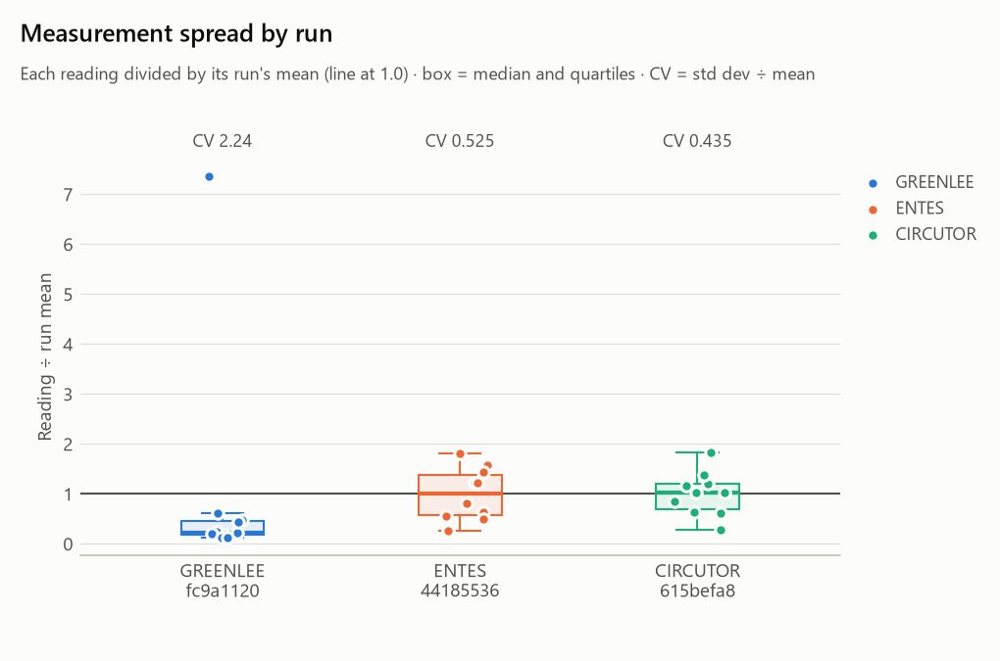
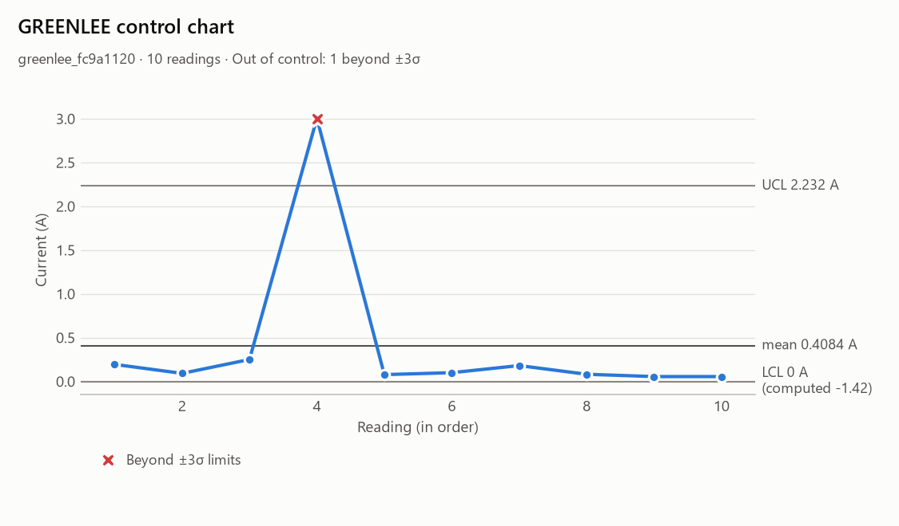

# Ammeter Testing Framework

[](https://github.com/rabinavidan/ammeter-testing-framework/actions/workflows/ci.yml)
· [Delivery architecture](https://rabinavidan.github.io/ammeter-testing-framework/)

A configuration-driven framework for testing three emulated ammeters (Greenlee, ENTES, CIRCUTOR): it samples
each device on a precise schedule, computes statistics, plots the readings, archives every run under a unique
test ID, compares the ammeter types for precision and accuracy, and can inject faults into the emulators to
exercise its own error handling.

The task specification is in [`Exam/ammeter-test-specification.md`](Exam/ammeter-test-specification.md)
(same content as the PDF next to it).

- [Quick start](#quick-start)
- [The ammeter emulators](#the-ammeter-emulators)
- [Usage](#usage)
- [Configuration](#configuration)
- [Sample test results](#sample-test-results)
- [Design decisions](#design-decisions)
- [Fixes to the provided code](#fixes-to-the-provided-code)
- [Libraries](#libraries)
- [Tests](#tests)
- [Project structure](#project-structure)

## Quick start

Run everything from the repository root (imports and the config path are relative to it). Developed with
Python 3.14 on Windows and verified on Linux (Python 3.14, Docker).

```sh
python -m venv .venv
.venv\Scripts\activate            # Windows   (macOS/Linux: source .venv/bin/activate)
pip install -r requirements-dev.txt          # or requirements-lock.txt for the exact verified versions

python main.py                    # start the emulators and take one reading from each
python -m examples.run_tests      # full demo: sample every ammeter, stats, plots, archive, accuracy report
python -m pytest                  # the test suite (26 tests)
```

`examples/run_tests.py` must be run with `-m` from the root (not `python examples/run_tests.py`), so that the
`src` and `Ammeters` packages resolve. It tests every ammeter in the config, starting an emulator for each one it
has a class for. Options:

| Option | Effect |
|---|---|
| `--config FILE` | use another config file (default `config/config.yaml`) |
| `--ports GREENLEE ENTES CIRCUTOR` | override the three configured ports (e.g. free ports in CI) |
| `--no-emulators` | start nothing; test the ammeters already listening at the configured hosts and ports (deployed emulators or real devices) |
| `--fail-on-errors` | exit with status 1 if any reading failed (for health checks) |

With only Docker installed: `docker compose run --rm demo` runs the demo and `docker compose run --rm tests` runs
every quality gate (see [docs/engineering.md](docs/engineering.md#docker)).

## The ammeter emulators

Each emulator is a TCP server on `localhost` that replies with one current reading, a UTF-8 number ending in a
newline, when it receives its exact command. Any other command gets the connection closed with no reply.

| Ammeter  | Port | Command                             | Measurement method                                    | Typical range   |
|----------|------|-------------------------------------|-------------------------------------------------------|-----------------|
| Greenlee | 5000 | `MEASURE_GREENLEE -get_measurement` | Ohm's law, I = V / R (V 1–10 V, R 0.1–100 Ω)           | 0.01 – 100 A    |
| ENTES    | 5001 | `MEASURE_ENTES -get_data`           | Hall effect, I = B · K (B 0.01–0.1 T, K 500–2000)      | 5 – 200 A       |
| CIRCUTOR | 5002 | `MEASURE_CIRCUTOR -get_measurement` | Rogowski coil, I = Σ V·dt (10 samples, V 0.1–1 V, dt 1–10 ms) | 0.001 – 0.1 A |

Every reading is drawn from fresh random inputs, so the three emulators are **not measuring a shared current**;
their ranges barely overlap. This matters for the accuracy assessment (see [design decisions: accuracy assessment](docs/design-decisions.md#accuracy-assessment)).

## Usage

### Running a test

`run_test` expects the emulators to be listening already (`examples/run_tests.py` starts them for you).

```python
from src.testing.test_framework import AmmeterTestFramework

framework = AmmeterTestFramework()                 # loads config/config.yaml
result = framework.run_test("entes")               # sampling as configured
result = framework.run_test("entes", {"measurements_count": 50})   # override sampling for one run

result["test_id"]        # e.g. "entes_c9d2558f"
result["values"]         # the readings, in amps
result["statistics"]     # mean, median, std_dev, min, max, range, coefficient_of_variation, count, success_rate
result["errors"]         # failed readings: index, time, exception type and message
result["error_counts"]   # e.g. {"TimeoutError": 2, "NoReplyError": 1, "ValueError": 1}
result["control_chart"]  # limits, readings beyond them, runs, trend test, in_control
result["timing"]         # worst lateness against the schedule, achieved frequency
result["warnings"]       # e.g. out of control, sampling below the mains Nyquist rate, fell behind schedule
result["plots"]          # PNG paths
result["archive_path"]   # results/archive/<test_id>.json
result["log_file"]       # <logging.output_dir>/<timestamp>_<test_id>.log
```

### Retrieving and comparing past runs

```python
archive = framework.archive
archive.list_runs()                    # every archived run, oldest first
archive.list_runs("greenlee")          # one ammeter type
record = archive.load("entes_c9d2558f")
record["metadata"]                     # archive time, host, platform, Python version, code fingerprint, config
archive.compare(["entes_c9d2558f", "entes_4fd9be26"], ["mean", "std_dev"])   # statistics side by side

framework.plot_comparison([archive.load(r["test_id"]) for r in archive.list_runs()])  # results/plots/comparison.png
```

### Accuracy assessment

```python
from src.analysis.accuracy import format_accuracy_report

assessment = framework.assess_accuracy()            # latest run per configured ammeter; or pass results
print(format_accuracy_report(assessment))           # also saved as JSON under results/accuracy/
```

### Accuracy verification against a reference current

The formula emulators can't be checked for accuracy: each reading is a fresh random current. For that,
give an emulator an `InstrumentModel` measuring a shared `ReferenceSource` (a calibrator), and sweep it:

```python
import threading
from Ammeters.Greenlee_Ammeter import GreenleeAmmeter
from Ammeters.instrument_model import ReferenceSource
from src.testing.calibration import build_instruments, format_sweep_table, run_accuracy_sweep, sweep_points

source = ReferenceSource()
instruments = build_instruments(framework.config, source)            # from accuracy_verification.instruments
threading.Thread(target=GreenleeAmmeter(6000, instrument=instruments["greenlee"]).start_server, daemon=True).start()
framework.register_ammeter("greenlee_instrument", 6000, "MEASURE_GREENLEE -get_measurement")

spec = framework.config["accuracy_verification"]["instruments"]["greenlee"]
points = sweep_points(spec, [0, 10, 50, 90, 100, -10, -50, -100])  # percent of range
sweep = run_accuracy_sweep(framework, "greenlee_instrument", source, instruments["greenlee"], points)
print(format_sweep_table(sweep))                     # per point: mean, error, tolerance, spec PASS/FAIL, En, |En| <= 1
```

The verdicts follow from the datasheet errors configured for each model (`gain_error`, `offset_a` in
`accuracy_verification.instruments`): the sweep shows that the verification method works, not how accurate the
provided emulators are, which have no true current to compare with. "spec" (within the datasheet tolerance) and
"|En| <= 1" (agrees with the reference within the combined uncertainty) are different questions, so the table
shows both: the Greenlee model passes its 0.5 % spec at all 8 points while |En| is above 1 at 7 of them (up to
11.8), because its 0.3 % gain error is much larger than its repeatability.

`run_supply_sweep` (same module) runs the setup from the specification's diagram: a 0-12 V supply powering the
embedded board through the meter. `python -m pytest -m acceptance` runs both for all three instruments, with the
tables attached to the Allure report.

### Error simulation

Set `error_simulation.enabled: true` in `config/config.yaml`, then run `python -m examples.run_tests`. The script
prints, per ammeter, the faults injected next to the errors the framework detected. To use it in your own code,
give each emulator a simulator:

```python
import threading
from Ammeters.error_simulation import ErrorSimulator
from main import run_entes_emulator

simulator = ErrorSimulator.from_config(framework.config, "entes")   # None when disabled
threading.Thread(target=run_entes_emulator, args=(simulator,), daemon=True).start()
...
simulator.counts()   # {"requests": 60, "no_response": 2, "corrupted_response": 1, ...}
```

## Configuration

Everything is driven by [`config/config.yaml`](config/config.yaml). Invalid values in any section (sampling,
ammeters, metrics, charts, accuracy, archive, logging switches, fault injection) are rejected with a clear
`ValueError` when the framework is created or `configure()`d, **before** any request is sent.

| Section | Key | Meaning |
|---|---|---|
| `testing.sampling` | `measurements_count`, `total_duration_seconds`, `sampling_frequency_hz` | Set any **two**; the third is derived (count = duration × frequency). If all three are set they must agree. Default: 10 readings at 5 Hz (2 s). One TCP connection per reading caps the rate at about 120-145 Hz. At 50 Hz or below readings are usually within a few ms of schedule (occasional outliers up to one interval on Windows); every run records its lateness and achieved rate in `timing` and warns when it fell behind. |
| `testing` | `request_timeout_seconds` | Per-request socket timeout (default 2.0). |
| `testing` | `mains_frequency_hz` | 50 or 60; sampling below twice this is recorded and warned about as aliasing. `null` turns the check off. |
| `ammeters.<type>` | `port`, `command`, `host` | One entry per ammeter; the name may use letters, digits, `_` and `-` (it becomes part of the test ID). The order sets each ammeter's chart color. |
| `ammeters.<type>` | `plausible_range_a` | Optional `[low, high]`; readings outside are recorded as `ImplausibleReadingError`, not data. Set to each formula's exact output range. |
| `analysis` | `statistical_metrics` | Which statistics to compute; empty = all. |
| `analysis.control_chart` | `sigma_limit`, `run_length` | `null` = automatic: 3 sigma and runs of 9 up to 40 readings, widening for longer runs so stable data isn't flagged for being long. A number fixes the rule. |
| `analysis.visualization` | `enabled`, `output_dir`, `plot_types` | Per-run PNGs: `time_series`, `histogram`, `control_chart`; empty = all. |
| `analysis.accuracy` | `reference_current_a` | Known true current. Without it, only relative spread (robust CV) can be ranked, not accuracy. |
| | `confidence_level`, `bootstrap_resamples`, `random_seed`, `output_dir` | Confidence interval settings and where reports are saved. |
| `result_management` | `enabled`, `archive_dir` | Archive every run as JSON. |
| `logging` | `output_dir` | Where each run's log file goes (default `results/logs`). |
| `error_simulation` | `enabled`, `seed`, `faults`, `ammeters` | Fault injection; off by default. `ammeters.<type>` overrides `faults` for one ammeter. |
| `accuracy_verification` | `instruments`, `points_percent_of_range`, `readings_per_point`, `supply_sweep`, ... | Realistic instrument models (datasheet errors and spec) and the test points for verifying them against a reference current; used by the acceptance tests. |

## Sample test results

[`sample_results/`](sample_results/) holds the complete output of one `python -m examples.run_tests` run of the
current code (10 readings per ammeter at 5 Hz; test IDs `greenlee_fc9a1120`, `entes_44185536`,
`circutor_615befa8`): the three archive records, their logs, all nine per-run charts, the comparison chart and the
accuracy report. It's a copy: paths inside the records still point to `results/`, where every run writes.
`results/` itself is in `.gitignore`, since it grows with every run. `tools/spec_audit.py` checks that every
sample record has every field the current code produces.

[`sample_results/reliability/`](sample_results/reliability/) is a second complete run, 2,000 readings per ammeter
at 50 Hz (its config is [`reliability/config.yaml`](sample_results/reliability/config.yaml)), made to answer the
"most reliable method" question, which 10 readings can't (see below).

[`allure-report.html`](sample_results/allure-report.html) is the Allure report of a full test-suite run
(26 passed): one self-contained file that opens directly in a browser.

**Statistics** (10 readings each):

| Ammeter  | Mean (A) | Std dev (A) | Coefficient of variation | Control chart |
|----------|---------:|------------:|-------------------------:|---------------|
| Greenlee | 0.4084   | 0.914       | 2.24                     | out of control: 1 reading beyond the limits |
| ENTES    | 41.28    | 21.7        | 0.52                     | in control |
| CIRCUTOR | 0.03135  | 0.0136      | 0.44                     | in control |

Each record also carries `timing` (worst lateness about 1 ms; achieved 5.00 Hz) and a warning that at 5 Hz any
50 Hz mains ripple would alias to 0 Hz (see [Aliasing](docs/design-decisions.md#aliasing)).

**Comparison chart** — the three runs on one scale, each reading divided by its run's mean:



**Control chart** — Greenlee, the least consistent of the three. One V / R reading of 3.0 A, more than seven
times the run's mean, is beyond the upper limit and is flagged. The computed lower limit (−1.42 A) is below anything a current
reading can be, so it is drawn at 0 A with the computed value beside it:



**Accuracy assessment and the most reliable method** — from the 2,000-reading run in
[`sample_results/reliability/`](sample_results/reliability/accuracy/), no reference current set (output condensed):

```
GREENLEE  (1 run(s), 2000 readings, success 1)
  mean 0.4238 A [0.325, 0.553]   median 0.113 A   U(k=2) +/-0.115 A
  CV 6.08 [3.58, 7.4]   robust CV 0.826 [0.778, 0.87]
ENTES  (1 run(s), 2000 readings, success 1)
  mean 69.75 A [67.9, 71.6]   median 62.66 A   U(k=2) +/-1.86 A
  CV 0.596 [0.58, 0.612]   robust CV 0.715 [0.683, 0.747]
CIRCUTOR  (1 run(s), 2000 readings, success 1)
  mean 0.03082 A [0.0301, 0.0315]   median 0.03084 A   U(k=2) +/-0.000689 A
  CV 0.5 [0.486, 0.514]   robust CV 0.59 [0.558, 0.632]

Ranking by robust cv (lower is better): CIRCUTOR > ENTES > GREENLEE
Most reliable: CIRCUTOR (clear winner: its CI is separate from the runner-up's)
```

**CIRCUTOR is the most reliable method: its readings have the smallest relative spread**, with a confidence
interval separate from the runner-up's. The robust CVs match the population values of each formula (200,000 draws:
CIRCUTOR 0.615, ENTES 0.711, Greenlee 0.808). Each emulator reading is a *different random current*, so this
compares how widely each formula spreads, not a meter's repeatability on one steady current (that is what the
[accuracy verification](#accuracy-verification-against-a-reference-current) sweep measures). CIRCUTOR's spread is
almost all its random time step; Greenlee's V / R spikes when R nears 0.1 Ω.

Establishing a winner takes this many readings: in simulation, a clear winner emerged 0/20 times at 10 and 40
readings per type, 12/20 at 1,000 and 20/20 at 2,000. The 10-reading sample also ranks CIRCUTOR first but
reports "not established at this sample size". All three pairs *disagree* (medians 3.7× to 2,000× apart), as
expected for devices not measuring the same current. ENTES and CIRCUTOR are in control over 2,000 readings;
Greenlee is not (35 readings beyond its limits, its heavy tail). Long runs widen the control-chart rules so that
stable data isn't flagged for being long ([details](docs/design-decisions.md#control-chart)).

**Error simulation** — the example script with simulation enabled and the configured fault set, 60 readings
per ammeter at 10 Hz (output condensed):

```
greenlee: 52/60 readings; injected: 3 no response, 2 dropped, 2 corrupted, 1 truncated, 11 fragmented, 6 late, 1 spike
          lost-reply faults injected: 8, failed readings detected: 8, implausible readings rejected: 0
entes:    52/60 readings; injected: 1 no response, 1 dropped, 1 corrupted, 4 truncated, 2 fragmented, 6 late, 1 spike
          lost-reply faults injected: 7, failed readings detected: 7, implausible readings rejected: 1
circutor: 50/60 readings; injected: 3 no response, 2 dropped, 1 corrupted, 2 truncated, 6 fragmented, 6 late, 2 spikes
          lost-reply faults injected: 8, failed readings detected: 8, implausible readings rejected: 2
```

Every fragmented reply (19) was reassembled into a correct reading; every truncated one was an error, not a
wrong number. Spikes ×10 that land outside an ammeter's plausible range are rejected (ENTES's one, CIRCUTOR's
two); Greenlee's landed inside its wide 0.01-100 A range and was kept as data, which is exactly what a control
chart is for.

## Design decisions

Each decision and why; the reasoning and the measurements behind them are in [docs/design-decisions.md](docs/design-decisions.md).

| Decision | Why |
|---|---|
| One framework class; statistics, charts, accuracy and archive as separate modules on plain result dicts | Each part is usable and testable alone, including on archived runs |
| Everything from `config/config.yaml`, validated before the first request | A typo fails in milliseconds, not after a full run; new tests need no code |
| Sampling on an absolute schedule (reading *i* at *i* / frequency) | Timing errors don't accumulate; failed readings are recorded and the run continues |
| Statistics in the standard library; sample std dev (n−1) | Minimal dependencies; correct for a sample of readings |
| One JSON file per run, unique ID, never overwritten | Any past run can be reloaded, compared and re-analysed |
| Control chart rules chosen by measuring them on the real emulators | First guesses gave false alarms (spikes faked runs and trends) |
| Without a known reference current, rank *relative spread*, not accuracy | The emulators share no true current; claiming accuracy would be wrong |
| Faults injected in the emulator, opt-in | The framework meets real socket failures; default behaviour is unchanged |
| Extension through registries (`METRICS`, `PLOT_TYPES`, `DEFAULT_FAULTS`) | A new metric, chart or fault is one entry, picked up by validation |

## Fixes to the provided code

| # | Problem | Fix |
|---|---|---|
| 1 | `main.py` started the emulators on ports 5001–5003; the README specifies 5000–5002. | Ports set to the README values, as named constants. |
| 2 | `main.py` sent bare commands (`MEASURE_GREENLEE`, …). Emulators only reply to an exact match, so they closed the connection with no data. | Full commands from the README. |
| 3 | `CircutorAmmeter` expected `MEASURE_CIRCUTOR -get_measurement -current`, which matched neither `main.py` nor the README. | Command changed to `MEASURE_CIRCUTOR -get_measurement`, per the README. |
| 4 | Greenlee printed `Ω`, which raises `UnicodeEncodeError` on a Windows cp1252 console. That killed the Greenlee server thread, so its request got no data. | Replaced with `Ohm`, so output works on any console. |
| 5 | `client.request_current_from_ammeter` printed the reading but returned nothing, and had no timeout, so a silent device would block forever. | Returns the reading as `float` (or `None` for no data); optional timeout. |
| 6 | `test_framework.py` used `Dict` without importing it, so importing the module failed with `NameError`. `run_test` was an empty stub. | Import added (and the relative import made absolute to match the rest of the code); `run_test` implemented. |
| 7 | `examples/run_tests.py` called `run_test()` without the ammeter type. | Passes `ammeter_type`; the script now starts the emulators and demonstrates every feature. |
| 8 | `TestLogger` built a log file name but never attached handlers or set a level, so nothing was logged. | Logs DEBUG+ to `results/logs/<timestamp>_<test>.log` (UTF-8) and INFO+ to the console, without duplicate lines when re-created. |
| 9 | `config.yaml` had empty sampling values and the `ammeters` section commented out. | Filled in, and extended for analysis, archiving and error simulation. |
| 10 | The emulator server loop had no error handling: a client resetting its connection raised out of the loop and stopped that emulator for the rest of the session. *(Found with error simulation.)* | Each connection is handled in a `try`; errors are logged and the server keeps serving. |
| 11 | `float()` accepts `"NaN"` and `"inf"`, so such a reply would have been stored as a reading and corrupted every statistic. *(Found with error simulation.)* | `run_test` rejects non-finite readings as errors. |
| 12 | The original README listed files that don't exist: `Ammeters/main.py`, `src/testing/AmmeterTester.py`, `examples/run_test.py`. | This README reflects the actual layout. |
| 13 | The client read a reply with a single `recv()` and the emulators sent no terminator, so a reply split in transit would have been parsed from its first piece: a wrong reading, silently. *(Found in the hardware review.)* | Replies end in a newline; the client reads until it; a cut-off reply raises `TruncatedReplyError`. |
| 14 | The emulator base class called `random.seed(time.time())` on every instance, reseeding Python's *global* generator: it disturbed every other user of `random` and made runs impossible to reproduce. *(Found in the architecture review.)* | Each emulator has its own `random.Random(seed)`; the formulas draw from it (`seed=` makes a run repeatable). |

Sampling validation also rejects NaN and infinite count, duration and frequency values before requests are sent,
with a `ValueError` naming the setting. The sampling regression test covers each non-finite value for all three keys.

## Libraries

**Installed:** `pytest` (9.2.0) and `allure-pytest` (2.16.2) for the tests and their report, and the development
tools `ruff`, `mypy`, `types-PyYAML`, `pytest-cov`, `pytest-xdist` and `pre-commit` for the quality gates. The Allure
command-line tool (2.43.0) that builds the report was already installed globally through npm
(`allure-commandline`); it isn't a Python package and needs Java 8 or later (the Docker `report` image includes
both).

`requirements.txt` originally listed numpy, scipy, matplotlib, seaborn, pyyaml and pandas. The code only uses two
of them, so the runtime requirements are now just those:

| Library | Used for |
|---|---|
| PyYAML | loading `config/config.yaml` |
| matplotlib (≥ 3.5) | charts (it installs numpy as its own dependency) |

`requirements-dev.txt` adds the test tools (pytest, allure-pytest) and the development tools (ruff: lint; mypy +
types-PyYAML: types; pytest-cov: coverage; pytest-xdist: parallel runs; pre-commit: git hooks).
`requirements-lock.txt` pins every package to the exact version the suite was verified with (Python 3.14),
generated from a clean environment so it contains nothing that isn't required (`tools/spec_audit.py` checks this);
Docker and the main CI jobs install from it.

Statistics, bootstrap intervals, the Mann-Kendall test, archiving and fault injection all use the Python standard
library only. CI runs the suite on Python 3.11-3.14 on Linux and Python 3.14 on Windows and macOS.

## Tests

The specification's *tests* are measurement runs against an ammeter: each call to `AmmeterTestFramework.run_test()`
is one, `python -m examples.run_tests` runs one per ammeter, and their output is the
[sample test results](#sample-test-results). The same runs are part of the pytest suite
(`tests/acceptance/`), so they appear, with their charts, in the Allure report.

The rest of the suite is an addition: [`tests/unit/`](tests/unit/) and [`tests/integration/`](tests/integration/)
check the framework's own code (sampling, statistics, archiving, charts, accuracy, error simulation) and include
a regression test for most of the [fixes to the provided code](#fixes-to-the-provided-code). Layers, markers,
commands and the Allure report are described in
[docs/engineering.md](docs/engineering.md#tests-and-the-allure-report).

## Project structure

```
main.py                       start the emulators and take one reading from each
config/config.yaml            all settings
Ammeters/
  base_ammeter.py             emulator base class (stoppable TCP server, own random generator)
  Greenlee_Ammeter.py, Entes_Ammeter.py, Circutor_Ammeter.py
  client.py                   request one reading; parse_reply() holds the protocol rules
  error_simulation.py         fault injection for the emulators
  instrument_model.py         realistic meters measuring a reference current (opt-in)
src/
  testing/test_framework.py   AmmeterTestFramework: config validation, sampling, public API, coordination
  testing/calibration.py      multi-point accuracy sweep, GUM uncertainty, supply sweep
  analysis/result_analysis.py statistics, control chart rules, aliasing
  analysis/visualization.py   per-run and comparison charts
  analysis/accuracy.py        cross-ammeter precision/accuracy assessment
  results/result_archive.py   JSON archive: save, load, list, compare
  utils/                      config loading, logging, random helper
examples/run_tests.py         end-to-end demo
tests/                        unit/, integration/, acceptance/ (see Tests)
sample_results/               the sample run, the 2,000-reading reliability run, allure-report.html
docs/                         design-decisions.md (the reasoning in full), engineering.md (tests, Docker, CI, ...)
Exam/                         the task specification
```

Beyond the specification, and not needed to use the framework (described in
[docs/engineering.md](docs/engineering.md)): quality gates and CI (`tools/check.py`, `.github/`,
`.pre-commit-config.yaml`), a live specification audit (`tools/spec_audit.py`), Docker (`Dockerfile`,
`docker-compose.yml`), Kubernetes with automatic promotion (`deploy/k8s/`, `tools/deploy.sh`, `Ammeters/serve.py`,
`tools/results_server.py`) and a browsable delivery-architecture page (`site/`, published to GitHub Pages). CI runs on
every push and pull request, and `main` accepts changes only through a pull request with a green `ci-gate`. The
deploy jobs are configured but off until a cluster is connected (`CD_ENABLED`).
