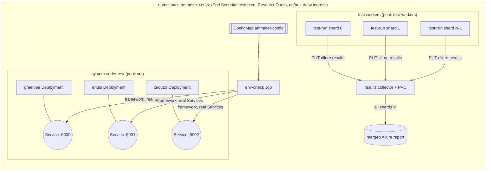

# Kubernetes: four environments, sharded test workers

Kustomize base plus one overlay per environment. Verified on a local 4-node cluster (Docker Desktop: 1 control
plane, 3 workers): staging, regression and preprod deployed and passing; production validated by a server-side
dry run (its devices are placeholders).

```sh
deploy/k8s/scripts/label-nodes.sh                      # node pools (local cluster defaults)
deploy/k8s/scripts/load-images.sh                      # local clusters only: images into every node
kubectl apply -k deploy/k8s/overlays/staging           # or regression | preprod | production
kubectl -n ammeter-staging wait --for=condition=complete job/test-run job/env-check --timeout=300s
```

## Architecture



Two workloads per environment, with different questions:

| Workload | Kind | Question it answers |
|---|---|---|
| **test-run** | Indexed Job, N pods (shards) | Does the **code** work? The pytest suite, split across nodes. |
| **env-check** | Job (CronJob in production) | Does the **environment** work? The framework run against the ammeters deployed *here*, through their Services. |

## Environments

| | staging | regression | preprod | production |
|---|---|---|---|---|
| Purpose | first stop for every new image | full regression, nightly | production-like gate before release | the real devices |
| System under test | emulators ×1 | emulators ×2 | emulators ×2 + PodDisruptionBudgets | **real ammeters** via selector-less Services + EndpointSlices |
| Test run | `sanity`, 2 shards | `regression and not timing`, 4 shards; nightly CronJob `regression` incl. timing | `acceptance or sanity`, 2 shards | none |
| Environment check | once per apply | once per apply | once per apply | **CronJob every 15 min** (monitoring; a failed Job is the alert) |
| Quota (requests cpu / mem / pods) | 3 / 3Gi / 15 | 6 / 6Gi / 30 | 4 / 4Gi / 20 | 1 / 1Gi / 5 |
| Images | as built | as built | **pinned** (`images:`, digest on a real cluster) | same pin as preprod |

**Automatic promotion (CD).** On a push to `main`, after the required `ci-gate`, CI builds both images once, tags
them with the commit SHA, pushes them to GitHub Container Registry, then runs `tools/deploy.sh` for staging,
regression, preprod and production in turn. The script pins the images with a throwaway Kustomize layer (the
overlays are untouched), deletes the previous run's Jobs (a Job is immutable), applies, and waits for the emulators,
the test run and the environment check; a failure prints the failed pods' logs and stops the promotion. Each deploy
job runs in a GitHub Environment of the same name with a `KUBECONFIG` secret; add required reviewers to `preprod` and
`production` for manual release gates. It is off until the repository variable `CD_ENABLED` is `true`; for a private
or local cluster set `CD_RUNNER` to a self-hosted runner label. By hand:
`tools/deploy.sh staging ghcr.io/<owner>/ammeter-qa:<sha> ghcr.io/<owner>/ammeter-qa-report:<sha>`. Verified on the
local cluster with a uniquely tagged image: staging deployed, emulators rolled out, both shards and the environment
check passed.

Promotion: one image is built once (CI), tested in staging → regression → preprod, and the exact digest that passed
preprod is pinned in production. Each image has its own name (`ammeter-qa`, `ammeter-qa-report`) because Kustomize
matches images by name: with a shared name, pinning one silently re-tagged the other (found when preprod first
failed: its collector ran the test image, without the Allure CLI).

## Nodes and pools

| Pool label `qa.ammeter/pool` | Runs | Local cluster | Real cluster |
|---|---|---|---|
| `sut` | emulator Deployments | desktop-worker | small, steady nodes; taint `qa.ammeter/pool=sut:NoSchedule` + matching tolerations |
| `test-workers` | test-run shards | desktop-worker2, desktop-worker3 | larger, autoscaled (or spot) nodes; tainted likewise |

Workloads **prefer** their pool (`preferredDuringScheduling` node affinity) and **spread** across nodes
(`topologySpreadConstraints` on `kubernetes.io/hostname`): on the local cluster the four test-run shards landed on
three nodes, and emulator replicas were spread rather than stacked. On a real cluster make the preference
`required` and taint the pools so nothing else lands on them.

## Sharding workers

- The Job is `completionMode: Indexed` with `completions = parallelism = PYTEST_SHARD_COUNT`; each pod gets
  `JOB_COMPLETION_INDEX`.
- `tests/conftest.py` sorts the collected test IDs and keeps every N-th from the index: shards are **disjoint, cover
  everything, and differ by at most one test** (verified: 61 + 60 + 62 + 62 = 245 at the time, the whole
  non-timing regression).
- `backoffLimitPerIndex: 1` retries a failed shard alone; `maxFailedIndexes` caps the damage.
- Each shard uploads its Allure results to the **results collector** (`tools/results_server.py`), which owns the
  volume and builds one merged report when the last shard arrives. A ReadWriteOnce volume can't be shared by pods on
  different nodes, so shards upload instead of mounting it; on a cloud cluster the same flow would use object
  storage (S3/GCS). A report failure is recorded in the run's status, never sent back as a dropped upload.
- To scale: raise the shard count in the overlay (completions, parallelism, `PYTEST_SHARD_COUNT` together) and the
  quota; the workers are stateless.

## Security

Every pod meets the **restricted** Pod Security Standard (enforced per namespace): non-root uid 1000, no privilege
escalation, all capabilities dropped, seccomp `RuntimeDefault`, read-only root filesystem (writable `emptyDir` only
at `/tmp` and the results folder). The service account mounts no API token. NetworkPolicies deny all ingress, then
allow only pods labelled `qa.ammeter/client=true` to reach the ammeters and only test workers to reach the collector
(verified: an unlabelled pod's connection timed out; a labelled one connected).

## Reading results

```sh
kubectl -n ammeter-regression logs -l app.kubernetes.io/name=test-run --tail=3       # each shard's verdict
kubectl -n ammeter-regression logs job/env-check | grep -A1 "^Results for"           # the environment check
POD=$(kubectl -n ammeter-regression get pod -l app.kubernetes.io/name=results -o name)
kubectl -n ammeter-regression cp "${POD#pod/}:/data/runs/test-run/report.html" report.html   # merged report
```

Jobs are immutable: to rerun, `kubectl -n <ns> delete job test-run env-check` and apply again (the nightly CronJob
creates a new, uniquely named Job each time, so its results land under their own run ID).
